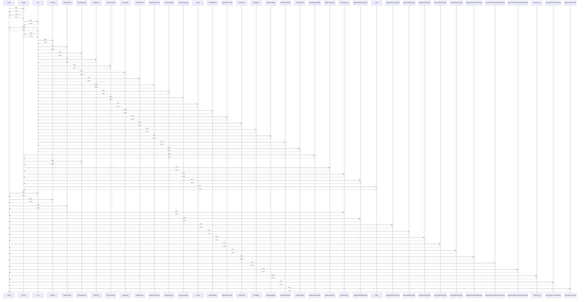

# GET()

> God node · 58 connections · [C:\Users\Admin\Desktop\Intern-main\app\api\zones\route.ts](file:///C:/Users/Admin/Desktop/Intern-main/app/api/zones/route.ts#L24)

## Call Trace Diagram

## Connections by Relation

### calls
- [[POST()]] `EXTRACTED`
- [[error]] `INFERRED`
- [[PATCH()]] `EXTRACTED`
- [[handleSubmit()]] `INFERRED`
- [[administrator()]] `EXTRACTED`
- [[findDbHeadViaManagers()]] `INFERRED`
- [[calculateRemainingTime()]] `EXTRACTED`
- [[generate1DayTrends()]] `EXTRACTED`
- [[generate7DayTrends()]] `EXTRACTED`
- [[generate30DayTrends()]] `EXTRACTED`
- [[generate90DayTrends()]] `EXTRACTED`
- [[getDepartmentStatsByRange()]] `EXTRACTED`
- [[generate7DayTrendsForDepartment()]] `EXTRACTED`
- [[generate30DayTrendsForDepartment()]] `EXTRACTED`
- [[checkGroup()]] `EXTRACTED`
- [[generateRecommendations()]] `EXTRACTED`
- [[requireAdministrator()]] `EXTRACTED`

### contains
- [[route.ts]] `EXTRACTED`
- [[route.ts]] `EXTRACTED`
- [[route.ts]] `EXTRACTED`
- [[route.ts]] `EXTRACTED`
- [[route.ts]] `EXTRACTED`
- [[route.ts]] `EXTRACTED`
- [[route.ts]] `EXTRACTED`
- [[route.ts]] `EXTRACTED`
- [[route.ts]] `EXTRACTED`
- [[route.ts]] `EXTRACTED`
- [[route.ts]] `EXTRACTED`
- [[route.ts]] `EXTRACTED`
- [[route.ts]] `EXTRACTED`
- [[route.ts]] `EXTRACTED`
- [[route.ts]] `EXTRACTED`
- [[route.ts]] `EXTRACTED`
- [[route.ts]] `EXTRACTED`
- [[route.ts]] `EXTRACTED`
- [[route.ts]] `EXTRACTED`
- [[route.ts]] `EXTRACTED`

---

*Part of the graphify knowledge wiki. See [[index]] to navigate.*