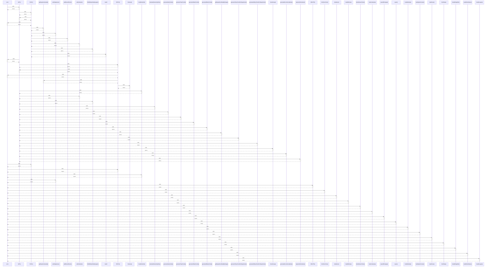

# error

> God node · 21 connections · [C:\Users\Admin\Desktop\Intern-main\app\liff\tickets\[id]\page.tsx](file:///C:/Users/Admin/Desktop/Intern-main/app/liff/tickets/%5Bid%5D/page.tsx#L106)

## Call Trace Diagram

## Connections by Relation

### calls
- [[GET()]] `INFERRED`
- [[POST()]] `INFERRED`
- [[PATCH()]] `INFERRED`
- [[handleSubmit()]] `EXTRACTED`
- [[verifySignature()]] `INFERRED`
- [[DELETE()]] `INFERRED`
- [[fetchZoneTree()]] `INFERRED`
- [[loadUsers()]] `INFERRED`
- [[loadAllZones()]] `INFERRED`
- [[handleSearchZone()]] `INFERRED`
- [[loadLineQuota()]] `INFERRED`
- [[saveAllChanges()]] `INFERRED`
- [[async()]] `INFERRED`
- [[handleDelete()]] `INFERRED`
- [[loadImportContext()]] `INFERRED`
- [[loadZones()]] `INFERRED`
- [[fetchData()]] `INFERRED`
- [[handleDragEnd()]] `INFERRED`
- [[loadOnlineStatus()]] `INFERRED`
- [[handleLogout()]] `INFERRED`

### contains
- [[page.tsx]] `EXTRACTED`

---

*Part of the graphify knowledge wiki. See [[index]] to navigate.*