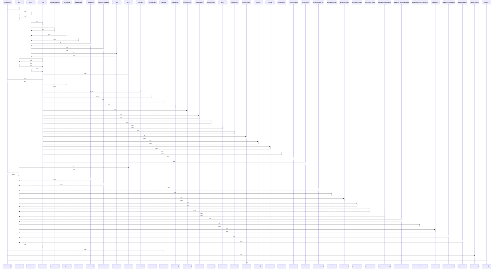

# handleSubmit()

> God node · 8 connections · [C:\Users\Admin\Desktop\Intern-main\app\staff\page.tsx](file:///C:/Users/Admin/Desktop/Intern-main/app/staff/page.tsx#L138)

## Call Trace Diagram

## Connections by Relation

### calls
- [[GET()]] `INFERRED`
- [[error]] `EXTRACTED`
- [[loadUsers()]] `EXTRACTED`
- [[validatePassword()]] `EXTRACTED`
- [[resetForm()]] `EXTRACTED`

### contains
- [[page.tsx]] `EXTRACTED`
- [[page.tsx]] `EXTRACTED`
- [[page.tsx]] `EXTRACTED`

---

*Part of the graphify knowledge wiki. See [[index]] to navigate.*