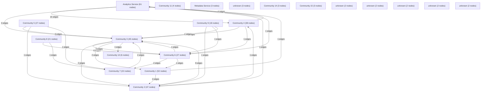

# Knowledge Graph Index

> Auto-generated by graphify. Start here — read community articles for context, then drill into god nodes for detail.

**390 nodes · 526 edges · 21 communities**

---

## System Architecture Flowchart

## Communities
(sorted by size, largest first)

- [[Analytics Service]] — 61 nodes
- [[Community 1]] — 52 nodes
- [[Community 2]] — 47 nodes
- [[Community 3]] — 45 nodes
- [[Community 4]] — 38 nodes
- [[Community 5]] — 27 nodes
- [[Community 6]] — 27 nodes
- [[Community 7]] — 22 nodes
- [[Community 8]] — 21 nodes
- [[Community 9]] — 18 nodes
- [[Community 10]] — 6 nodes
- [[Community 11]] — 4 nodes
- [[Metadata Service]] — 3 nodes
- [[unknown]] — 3 nodes
- [[Community 14]] — 3 nodes
- [[Community 15]] — 3 nodes
- [[unknown]] — 2 nodes
- [[unknown]] — 2 nodes
- [[unknown]] — 2 nodes
- [[unknown]] — 2 nodes
- [[unknown]] — 2 nodes

## God Nodes
(most connected concepts — the load-bearing abstractions)

- [[GET()]] — 58 connections
- [[POST()]] — 29 connections
- [[dynamic]] — 26 connections
- [[error]] — 21 connections
- [[PATCH()]] — 10 connections
- [[revalidate]] — 8 connections
- [[handleSubmit()]] — 8 connections
- [[[loading, setLoading]]] — 7 connections
- [[router]] — 7 connections
- [[searchParams]] — 5 connections

---

*Generated by [graphify](https://github.com/safishamsi/graphify)*